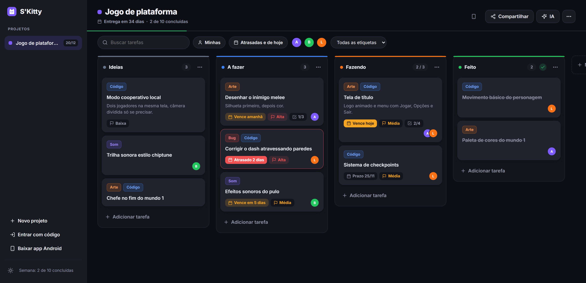
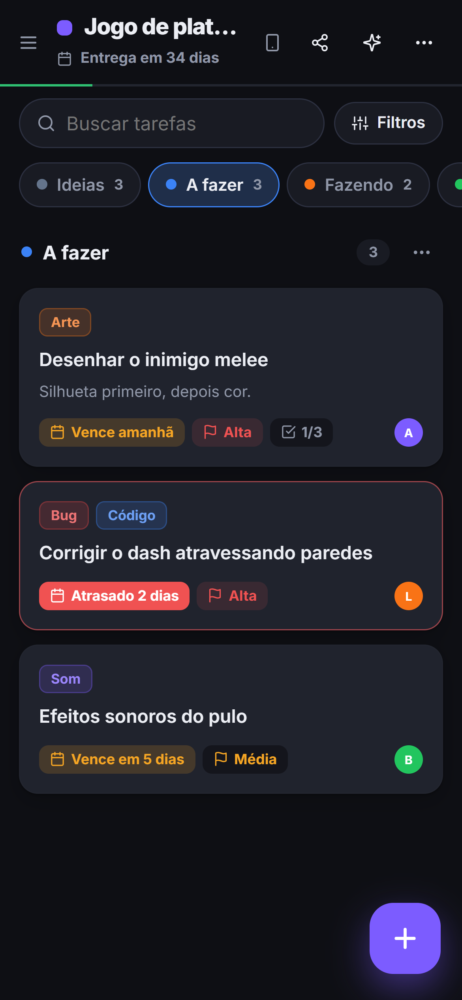

<div align="center">


# S'Kitty

**Quadro de tarefas simples, bonito e colaborativo, com API para IA.**

Organize projetos em colunas, compartilhe por um código e deixe o Claude, o ChatGPT ou o Gemini criarem tarefas por você.


<picture>
  <source media="(prefers-color-scheme: light)" srcset="docs/screenshot-light.png" />
  
</picture>

</div>

## Recursos

- **Projetos e colunas do seu jeito:** nome, cor, limite de tarefas, ordem e coluna de concluídas.
- **Cartões completos:** descrição em markdown, imagens (escolher, arrastar ou colar), links, checklist, etiquetas, prioridade, responsáveis e prazo.
- **Prazo que salta aos olhos:** "Atrasado 2 dias", "Vence hoje", "Vence amanhã", "Vence em 5 dias".
- **Filtros rápidos:** busca, "Minhas tarefas", atrasadas, de hoje, por pessoa e por etiqueta.
- **Trabalho em equipe:** gere um código `SK-XXXX-XXXX`, mande para quem vai usar e o quadro sincroniza a cada poucos segundos.
- **Integração com IA:** copie o contexto do quadro para qualquer chat e cole a resposta de volta como tarefas. Agentes podem usar a API direto.
- **Funciona em qualquer lugar:** no navegador, instalado como app (PWA, funciona sem internet) ou como app Android.
- **Visual ajustável:** tema claro e escuro, cor de destaque e cartões compactos.
- **Sem cadastro:** tudo fica salvo no navegador. Quadros compartilhados também ficam no Netlify Blobs.

## Começar

Precisa do [Node.js](https://nodejs.org/) 20 ou mais novo.

```bash
git clone https://github.com/SEU-USUARIO/skitty.git
cd skitty
npm install
npm run dev
```

Abre em http://localhost:5173. Nesse modo a API não roda, então tudo funciona menos o compartilhamento.

Para rodar com a API, use o Netlify CLI:

```bash
npm install -g netlify-cli
netlify dev
```

### Scripts

| Comando | O que faz |
|---|---|
| `npm run dev` | App em modo de desenvolvimento, sem API |
| `npm run build` | Gera o site em `dist/` |
| `npm run preview` | Serve o build localmente |
| `npm test` | Testes do modelo de dados e da API |
| `npm run build:android` | Build do site para o app Android e `cap sync` |

## Publicar no Netlify

1. Envie este repositório para o GitHub.
2. No Netlify: **Add new site**, **Import an existing project**, escolha o repositório.
3. As configurações já vêm do `netlify.toml` (build `npm run build`, pasta `dist`). Clique em **Deploy**.

Os quadros compartilhados ficam no Netlify Blobs, incluso no plano grátis. Não precisa de banco de dados.

> Arrastar a pasta `dist` no Netlify Drop publica só o visual, sem a API. Para compartilhar quadros e usar a integração com IA, publique pelo GitHub ou pelo `netlify deploy --build --prod`.

## API para agentes de IA

Cada quadro compartilhado tem um código (`SK-XXXX-XXXX`) que funciona como chave. Com ele, qualquer agente pode ler e editar o quadro:

```bash
# Ler o quadro em texto
curl https://SEU-SITE.netlify.app/api/boards/SK-XXXX-XXXX?format=md

# Criar uma tarefa
curl -X POST https://SEU-SITE.netlify.app/api/boards/SK-XXXX-XXXX/cards \
  -H "content-type: application/json" \
  -d '{"title": "Desenhar o inimigo", "column": "A fazer", "tags": ["Arte"], "priority": 3}'
```

| Ação | Requisição |
|---|---|
| Ler o quadro | `GET /api/boards/{code}` (ou `?format=md`) |
| Mudar nome ou prazo do projeto | `PATCH /api/boards/{code}` |
| Criar tarefa | `POST /api/boards/{code}/cards` |
| Editar ou mover tarefa | `PATCH /api/boards/{code}/cards/{id}` |
| Apagar tarefa | `DELETE /api/boards/{code}/cards/{id}` |
| Criar coluna | `POST /api/boards/{code}/columns` |
| Criar várias tarefas de uma vez | `POST /api/boards/{code}/import` |
| Especificação OpenAPI | `GET /api/openapi.json` |

O guia completo para agentes, com todos os campos e o formato de importação em texto, está em [`CLAUDE.md`](CLAUDE.md).

## App Android



O app Android é feito com [Capacitor](https://capacitorjs.com/) e fica em `android/`. Ele leva o site dentro dele, funciona sem internet e usa a API publicada (`VITE_SITE_URL` em `.env.android`) para compartilhar.

```bash
npm run build:android
cd android
./gradlew assembleDebug      # no Windows: gradlew.bat assembleDebug
```

O APK sai em `android/app/build/outputs/apk/debug/app-debug.apk`. Para compilar é preciso o Android SDK (vem com o Android Studio) e Java. O projeto usa Gradle 9.1, que aceita o Java do Android Studio (`JAVA_HOME` apontando para `Android Studio/jbr`).

Para atualizar o botão "Baixar app Android" do site, copie o APK novo para `public/SKitty.apk`.

<br clear="right" />

## Estrutura

```
skitty/
├── src/                     App React
│   ├── components/          Quadro, cartão, diálogos, notas e ícones (ui.jsx)
│   ├── useStore.js          Estado local salvo no navegador
│   ├── useSync.js           Sincronização com a API
│   └── styles.css
├── shared/
│   ├── model.js             Modelo de dados, junção de edições e importação de texto
│   └── openapi.js           Especificação da API
├── netlify/functions/
│   └── api.mjs              API em /api/*
├── public/                  Ícones, manifesto, service worker e APK
├── scripts/                 Testes (npm test)
├── android/                 Projeto Android (Capacitor)
├── docs/                    Imagens do README
├── CLAUDE.md                Guia para agentes de IA
└── netlify.toml
```

## Contribuir

- Toda mudança de dados passa pelas funções de `shared/model.js`, que cuidam do `updatedAt` usado na sincronização.
- Textos da interface sem emojis e sem travessão. Ícones são SVG em `src/components/ui.jsx`.
- Rode `npm test` antes de mandar um pull request.

## Licença

[MIT](LICENSE)
